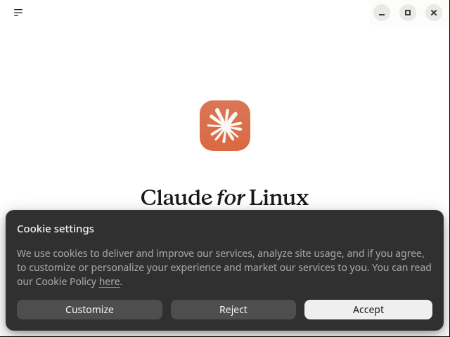

# Claude Desktop sur AlmaLinux

Script d'installation de **Claude Desktop** (Linux) sur AlmaLinux, RHEL, Rocky et Fedora (EL9+), avec **mise à jour automatique**.

Anthropic ne publie Claude Desktop pour Linux qu'en `.deb`. Le projet communautaire [aaddrick/claude-desktop-debian](https://github.com/aaddrick/claude-desktop-debian) reconditionne ce `.deb` officiel en RPM (fichiers d'Anthropic non modifiés) dans un dépôt DNF signé. Ce script s'appuie dessus.

> ⚠️ Projet non officiel, sans lien avec Anthropic. Le paquet installé s'appelle `claude-desktop-unofficial`.



## Ce que fait le script

- Télécharge la clé GPG du dépôt, **vérifie son empreinte** (épinglée dans le script) puis ajoute le dépôt (`gpgcheck=1`, `repo_gpgcheck=1`).
- Installe les bibliothèques d'exécution : le RPM n'en déclare aucune.
- Installe `claude-desktop-unofficial`.
- Met en place un **timer systemd** de mise à jour.

## Installation

```bash
curl -fsSLO https://raw.githubusercontent.com/ShaNouhAr/claude-desktop-almalinux/main/install-claude-desktop.sh
chmod +x install-claude-desktop.sh
sudo ./install-claude-desktop.sh install
```

Options :

| Option | Effet |
|---|---|
| `--epel` | active EPEL + CRB pour l'icône de la barre système (appindicator) |
| `--no-auto-update` | n'installe pas le timer de mise à jour automatique |
| `--rpm FICHIER\|URL` | installe un RPM précis au lieu du dépôt |

Un journal est écrit dans `/var/log/claude-desktop-install.log`.

## Mises à jour

Le timer `claude-desktop-update.timer` s'exécute 3 min après le démarrage, puis toutes les 6 h. Il :

- ne met à jour **que** `claude-desktop-unofficial`, jamais le reste du système ;
- **reporte la mise à jour si Claude est ouvert** : remplacer les fichiers d'Electron pendant qu'il tourne le fait planter. La mise à jour se fera au passage suivant, une fois l'app fermée.

Commandes manuelles :

```bash
sudo ./install-claude-desktop.sh update          # mettre à jour maintenant (si l'app est fermée)
sudo ./install-claude-desktop.sh update --force  # même si l'app est ouverte
sudo ./install-claude-desktop.sh status          # versions installée / disponible, état du timer
sudo dnf upgrade claude-desktop-unofficial       # fonctionne aussi
```

## Désinstallation

```bash
sudo ./install-claude-desktop.sh uninstall          # paquet + timer (garde ~/.config/Claude)
sudo ./install-claude-desktop.sh uninstall --purge  # retire aussi le dépôt et sa clé GPG
```

## Tests

`test/run-docker-tests.sh` déroule un cycle complet dans des conteneurs AlmaLinux 9 et 10 :

1. installation d'une ancienne version ;
2. lancement de l'app sur un écran virtuel, avec détection du logo dans une capture ;
3. vérification que la mise à jour est reportée pendant que l'app tourne ;
4. mise à jour une fois l'app fermée, puis relance de la nouvelle version ;
5. `status`, puis désinstallation `--purge`.

```bash
test/run-docker-tests.sh        # 9 et 10
test/run-docker-tests.sh 9      # une seule version
```

Les résultats et les captures sont écrits dans `test/out/`.

| Environnement | Install | Mise à jour | Désinstall | Rendu |
|---|---|---|---|---|
| AlmaLinux 9.8 (Docker) | ✅ | ✅ | ✅ | ✅ |
| AlmaLinux 10.2 (Docker, sans GPU) | ✅ | ✅ | ✅ | ⚠️ fenêtre blanche (voir ci-dessous) |
| AlmaLinux 10.2 (VM, GNOME Wayland) | ✅ | ✅ (timer systemd réel) | — | ✅ |

**À propos du rendu sur AlmaLinux 10 en conteneur.** Les tests lancent l'app avec `--disable-gpu`, faute de GPU dans le conteneur. Dans ce cas, Chromium utilise le rendu logiciel SwiftShader, qui affiche une page blanche sur EL10. Sur un vrai poste, avec un GPU, même virtuel, l'app s'affiche normalement : c'est vérifié sur une VM AlmaLinux 10 sous GNOME, voir la capture en haut de page. Le lanceur du paquet ne passe jamais `--disable-gpu`.

AlmaLinux 10 ne fournit plus de Xvfb. Le test EL10 utilise donc un Xvfb qui tourne dans un conteneur AlmaLinux 9 voisin et partage son socket X11.

## Licence

MIT. Claude Desktop reste soumis aux conditions d'Anthropic.
